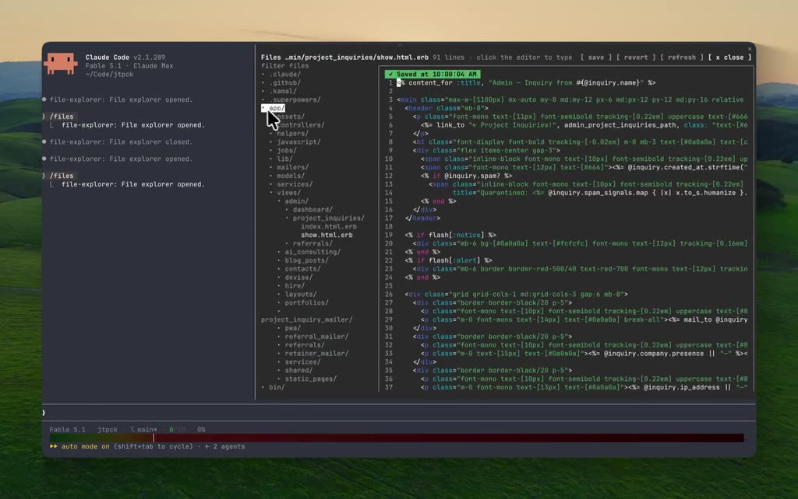
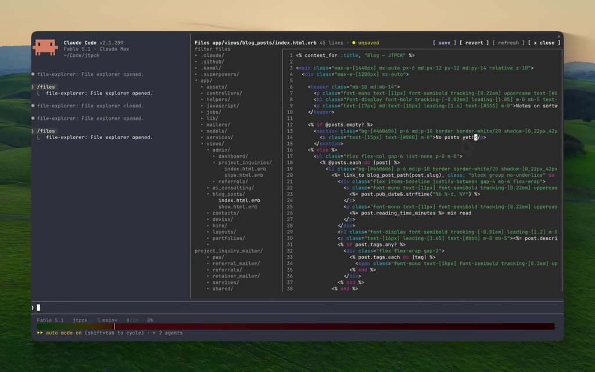
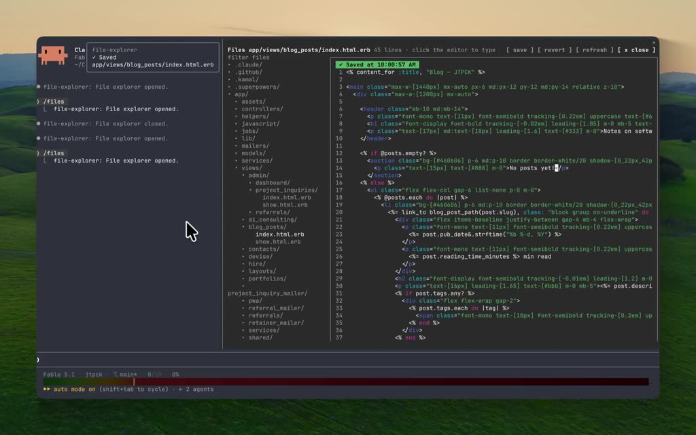

# Claude Code 안에 mods 로 만든 파일 탐색기·에디터

> 작성일: 2026-10-06
> 목적: 시연 영상 「클로드코드 내에 mods 로 에디터」에 보이는 화면을 정리하고, mods 로 어디까지 만들 수 있는지를 본 프로젝트 관점에서 남긴다.

## 개요

| 항목 | 내용 |
|------|------|
| 파일 | `클로드코드 내에 mods 로 에디터.mp4` (이 폴더) |
| 길이 | 31초 |
| 화면 | 1148x720, 터미널 화면 녹화 |
| 음성 | 정리에 쓰지 않음 (아래 "정리 방법과 한계") |
| 출처 | 확인 안 됨 — 내려받은 파일만 있고 원본 주소·작성자는 받지 못했다 |
| 사용 기술 | Claude Code CLI + Plugin Mods + Highlight JS (영상을 전해 준 사람의 설명) |
| 영상 속 버전 | Claude Code v2.1.289 |

영상은 Claude Code 터미널 안에서 `/files` 한 줄로 **파일 탐색기와 코드 에디터가 붙은 패널**을 열고,
파일을 골라 한 글자를 고친 뒤 저장하고 닫는 과정을 보인다. 모델은 한 번도 부르지 않는다.
전부 mods(함수 훅 플러그인)가 그린 화면이다.

### 타임라인

| 시각 | 화면 |
|------|------|
| 00:00 | 빈 Claude Code 세션. 대화 기록에 `file-explorer: File explorer opened.` / `closed.` 줄이 남아 있다 |
| 00:02 | 프롬프트에 `/files` 입력. 자동 완성 설명: "Open the file explorer pane (optionally `/files <path>` to open a file)" |
| 00:04 | 패널이 대화 오른쪽에 붙어 열린다. 왼쪽은 폴더 트리, 오른쪽은 줄 번호와 문법 색이 입혀진 에디터 |
| 00:06 | 트리에서 `app/` 을 눌러 접는다 — 최상위 폴더와 파일 목록만 남는다 |
| 00:08 ~ 00:12 | `app/` 을 다시 펴고 마우스를 내려 가며 폴더를 훑는다. 마우스가 올라간 줄이 밝게 반전된다 |
| 00:14 | `blog_posts/` 를 눌러 편다 — 그 아래 파일 두 개가 나타난다 |
| 00:16 | `index.html.erb` 를 누른다 — 에디터가 그 파일로 바뀌고 머리줄이 `app/views/blog_posts/index.html.erb 45 lines` 가 된다 |
| 00:18 ~ 00:20 | 에디터 안 13번째 줄 글자 사이를 눌러 커서를 놓는다 |
| 00:22 | `!` 한 글자를 친다. 머리줄에 `● unsaved` 가 뜨고 `[ save ]` `[ revert ]` 가 굵어진다 |
| 00:24 | `[ save ]` 를 누른다 |
| 00:26 | 왼쪽 위에 토스트 `file-explorer ✓ Saved app/views/blog_posts/index.html.erb`, 에디터 위에 `✓ Saved at 10:00:57 AM` |
| 00:28 | `[ x close ]` 를 누른다 |
| 00:29 | 패널이 사라지고 대화 기록에 `file-explorer: File explorer closed.` 가 추가된다 |

## 화면 구성

패널 한 장에 세 구역이 들어 있다.

| 구역 | 보이는 것 |
|------|-----------|
| 머리줄 | `Files <경로> <N> lines · click the editor to type` 와 버튼 네 개 `[ save ] [ revert ] [ refresh ] [ x close ]` |
| 왼쪽 트리 | 맨 위 `filter files` 입력 칸, 그 아래 폴더(`▸`/`▾`)와 파일. 폴더를 누르면 펴고 접힌다 |
| 오른쪽 에디터 | 테두리 안에 줄 번호, 문법 색, 저장 상태 줄(`✓ Saved at <시각>`), 커서 |

상태가 화면에 드러나는 방식:

- 고치기 전: 머리줄에 `click the editor to type`, `[ save ]` `[ revert ]` 는 흐리다.
- 고친 뒤: 머리줄이 `● unsaved` 로 바뀌고 두 버튼이 굵어진다.
- 저장 뒤: 토스트 한 번 + 에디터 위 저장 시각. 머리줄은 다시 `click the editor to type`.

## mods 의 어떤 부품으로 만들었나

아래 표의 "근거" 열을 구분해 읽는다. **확인**은 2026-10-06 에 본 프로젝트에서 `plugin-authoring` 스킬의
타입 파일·참고 문서를 읽거나 직접 모드를 만들어 본 것이고, **추정**은 화면을 보고 짐작한 것이다.
영상의 소스 코드는 받지 못했다.

| 화면에 보이는 것 | 대응하는 부품 | 근거 |
|------------------|---------------|------|
| `/files` 명령과 자동 완성 설명 | `$.command.register` + `command.run` 훅 | 확인 — 같은 방식으로 `/tool-calls`, `/roster` 를 만들었다 |
| 대화 옆에 붙는 패널 | `$.ui.open` + `ui.render` 훅(`component: 'Pane'`) | 확인 — 자리는 엔진이 정한다(`dock`/`inline`) |
| 패널이 화면의 절반 이상을 차지 | `$.ui.open` 의 `columns` 요청 | 확인(옵션 존재) — 영상이 실제로 이 옵션을 썼는지는 추정 |
| 머리줄 버튼 네 개 | `Button` | 확인 |
| `filter files` 입력 칸 | `Input` | 확인(부품 존재) — 영상에서 입력하는 장면은 없다 |
| 저장 토스트 | `$.ui.toast` | 확인(부품 존재) |
| 대화 기록의 `file-explorer: … opened.` 줄 | `command.run` 이 돌려주는 `{ text }` | 확인 — `/tool-calls` 가 같은 모양으로 남는다 |
| 파일 읽기·쓰기 | `$.fs.list` / `read` / `write` | 확인 — `list`·`read` 로 `file-explorer` 모드를 만들어 시험했다. `write` 는 선언만 확인 |
| 에디터(글자 사이 클릭으로 커서, 바로 타이핑) | `Client` 요소로 보인다 | 추정 — 타입 파일에 "키·포인터를 받는 `Client`, 터미널·데스크톱만" 이라고 적혀 있다 |
| 트리 줄에 마우스를 올리면 반전 | `Box` 의 `hover` 스타일 | 추정 — 타입 파일에 `hover` 가 있다 |
| 문법 색 | 영상은 Highlight JS(전해 들음). 엔진에는 자체 하이라이터로 그리는 `Code` 부품이 따로 있다 | `Code` 는 확인 — 줄 번호·언어 추론 포함. 영상이 어느 쪽을 썼는지는 추정 |

Highlight JS 를 어떻게 실었는지는 확인하지 못했다. 타입 파일에 따르면 훅 모듈은 DOM 도 Node 도 없는
전용 환경에서 돌고, 플러그인 안의 파일만 `import` 할 수 있다. 그러므로 라이브러리 파일을 플러그인
폴더에 함께 넣었을 가능성이 높다(추정).

## 따라 만든 것 (2026-10-06)

이 문서를 바탕으로 `file-explorer` 모드 1단계를 만들었다. 위치는 `~/.claude/skills/file-explorer/` (저장소 밖).

| 단계 | 내용 | 상태 |
|------|------|------|
| 1 | 폴더 트리(펴고 접기) + 읽기 전용 보기(줄 번호·문법 색) + 쪽 넘기기 | 완료. 처음엔 엔진의 `Code` 부품을 썼으나 실제 화면에서 색이 안 나와(원인 미확인) 직접 색칠로 바꿨다 |
| 2 | `filter files` 입력 칸 | 안 함 |
| 3 | 편집·저장(`Client` 화면 모듈, `● 저장 안 됨`, 저장 토스트) | 완료. 편집 중에도 문법 색이 들어간다 |
| 4 | 문법 색 — Prism.js 1.29.0 으로 파일 전체를 분석해 조각 종류별 테마 색으로 칠한다(22개 언어. vue·svelte 는 마크업 문법으로) | 완료 — 전체 시험 33건 통과. 처음엔 한 줄씩 보는 규칙을 직접 만들었다가 Prism 으로 바꿨다. 영상이 쓴 Highlight JS 는 쓰지 않았다 |
| 5 | 스크롤 — 마우스 휠(`ui.scroll`)로 트리·파일·에디터를 넘기고, 세로 막대로 위치를 보인다. 가로 막대로 긴 줄을 넘긴다 | 완료 — 전체 시험 50건 통과. `[ 이전 ] [ 다음 ] [ ← ] [ → ]` 버튼은 없앴다 |
| 6 | 트리와 가로 막대를 `Client` 화면 모듈로 — 마우스 누름을 직접 받아, 빠르게 눌러도 글자가 선택되지 않게 | 완료(시험 통과). 실제 화면에서 선택이 안 일어나는지는 미확인 |

만들면서 알게 된 엔진 규칙:

- `$`(엔진 인터페이스)와 상태 참조(`atom`)는 다른 파일로 넘길 수 없다. 쓰는 파일 안에 직접 적는다.
- 모드가 스스로 부른 `$.ui.open` 은 자기 `ui.open` 훅을 거치지 않는다. 열기 전에 할 일은 여는 쪽에서 한다.
- 엔진은 상대 경로를 세션 작업 폴더 기준 절대 경로로 바꿔 아래로 넘긴다.
- 문법 색은 `Code` 부품이 맡으므로 읽기 전용 보기에는 Highlight JS 가 필요 없다.
- 화면 모듈(`Client`)의 `post` 는 한 프레임에 마지막 것만 전달된다. 변경분이 아니라 전체 내용을 보낸다.
- 화면 모듈이 받는 영역 크기는 첫 배치 전에 0 이다. 첫 그리기에 쓸 크기는 훅 쪽에서 값으로 넘긴다.
- 세션 상태(`$.state`)는 모드를 다시 읽어도 남는다. 상태 모양을 바꾸면 옛 모양을 채우는 처리가 필요하다. 값에 `undefined` 가 섞여 화면 모듈로 넘어가면 패널 전체가 빈 화면이 된다.
- 외부 라이브러리는 모드 폴더 안의 파일로 넣어야 한다(npm 설치 불가, `require` 없음). Prism 은 축소판 파일들을 한 파일로 이어 붙이고 끝에 `export default Prism` 한 줄을 더해 ES 모듈로 만들었다(`tools/build-prism.sh`). 훅 모듈과 화면 모듈 양쪽에서 읽힌다.
- 패널 위의 휠과 스크롤 키는 `ui.scroll` 이벤트로 온다(몇 줄, 마우스가 있던 칸). 훅이 `next` 없이 답하면 엔진은 패널을 옮기지 않으므로, 머리줄은 고정하고 자기 줄만 옮길 수 있다. 휠은 위아래만 있다.
- `Client` 영역 안에서 마우스를 누르면 뗄 때까지 그 영역이 마우스를 잡는다(설명서: 대화 기록이 선택되지도 스크롤되지도 않는다). 엔진 `Button` 에는 선택을 막는 속성이 없다.
- 화면 모듈이 한 번도 `setState` 하지 않았으면 `surface.state` 는 계속 `undefined` 다. 매번 지금 값으로 새 상태를 만들면 "이전 값과의 차이"를 볼 수 없다. 기준점은 고정값으로 두고, 값을 되돌리는 일은 훅 쪽에서 한다.
- 한 모드가 `$.ui.close({ id })` 로 다른 모드의 패널도 닫을 수 있다(2026-10-06 실제 화면에서 확인: 세 모드의 패널을 한 버튼으로 닫았다). 탭 줄은 엔진이 그려서 모드가 버튼을 넣을 수 없으므로, 닫기 버튼은 패널 첫 줄의 오른쪽 끝에 둔다.
- 한글은 한 글자가 두 칸이다. 줄은 글자 수가 아니라 화면 칸 수로 잘라야 다음 행으로 넘치지 않는다.
- `Client` 안에서는 `Code` 를 커서와 함께 쓸 수 없어, 편집 중 문법 색은 토큰을 직접 나눠 칠해야 한다(영상이 Highlight JS 를 쓴 이유로 보인다 — 추정).

## 본 프로젝트에 주는 것

같은 날 본 프로젝트에서 만든 연습용 모드 두 개와 견주면 차이가 분명하다.

| | 우리가 만든 것 (`tool-calls-pane`, `hermes-roster-pane`) | 영상 |
|---|---|---|
| 패널 내용 | 글자 줄 나열 + 버튼 1개 | 트리 + 에디터 + 버튼 4개 + 입력 칸 |
| 입력 | 버튼 누르기 | 마우스 클릭 위치, 타이핑 |
| 데이터 | 세션 상태, 외부 명령 출력 | 파일 읽기·쓰기 |
| 상태 표시 | 건수 한 줄 | unsaved 표시, 버튼 강조, 토스트, 저장 시각 |

여기서 얻는 것은 세 가지다.

1. **패널은 "보는 화면"에 그치지 않는다.** 누르고, 치고, 저장하는 작은 앱이 된다. 명부 패널도 줄을 눌러
   그 에이전트의 방을 여는 식으로 넓힐 수 있다.
2. **모델을 부르지 않는다.** 영상의 조작은 모두 모드가 직접 처리한다. 조회·전환처럼 판단이 필요 없는
   일을 패널로 옮기면 그만큼 대화 턴이 줄어든다(사용량을 재서 확인한 것은 아니다).
3. **상태를 세 군데에서 동시에 알린다.** 머리줄 표시, 버튼 강조, 토스트. 한 군데만 바뀌면 놓치기 쉽다는
   점을 화면 설계로 풀었다.

## 정리 방법과 한계

- 영상에서 프레임 16장(약 2초 간격, 가로 1024px)을 뽑아 화면 글자를 읽어 정리했다.
- 음성 인식은 하지 않았다. `watch` 스킬의 음성 인식용 API 키가 이 컴퓨터에 없다. 화면만으로 흐름이
  끊기지 않아 내용 손실은 없다고 보지만, 영상에 해설 음성이 있었다면 그 내용은 빠져 있다.
- 2초 간격이라 그 사이의 짧은 동작(예: 클릭 순간)은 앞뒤 프레임 차이로 짐작했다.
- 폴더 이름의 `coce` 는 `code` 의 오타로 보이나, 받은 그대로 두었다.

## 스크린샷

| 파일 | 시각 | 장면 |
|------|------|------|
| `screenshots/01-slash-files-command.jpg` | 00:02 | `/files` 입력과 자동 완성 설명 |
| `screenshots/02-pane-tree-and-editor.jpg` | 00:04 | 패널 전체 — 트리와 에디터 |
| `screenshots/03-open-another-file.jpg` | 00:16 | 다른 파일을 눌러 연 직후 |
| `screenshots/04-unsaved-after-typing.jpg` | 00:22 | 한 글자 친 뒤 `● unsaved` |
| `screenshots/05-saved-toast.jpg` | 00:26 | 저장 토스트와 저장 시각 |
